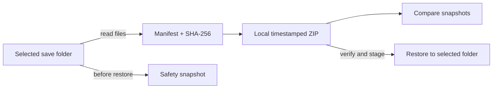

# SaveHarbor

**A local-first backup manager for PC game saves.** SaveHarbor creates timestamped ZIP snapshots, verifies every saved file with SHA-256, compares two snapshots, and restores files with a safety copy of the current state.

> SaveHarbor does not upload, sync, encrypt, or automatically delete your files. Backups stay on this computer until you move or remove them.

## What it does

- Organizes save folders into named game profiles.
- Creates portable ZIP snapshots with a JSON manifest and per-file SHA-256 hashes.
- Compares two snapshots and lists added, removed, changed, and unchanged files.
- Verifies a snapshot before restore and checks hashes again after staging its files.
- Creates a safety snapshot before the app restores files.
- Rejects unsafe archive paths, duplicate entries, unexpected files, oversized snapshots, and unsupported formats.
- Offers both a graphical desktop app and a small command-line interface.

## Quick start on Windows

1. Install [Python 3.11 or newer](https://www.python.org/downloads/windows/) and enable **Add python.exe to PATH** in the installer.
2. Download `SaveHarbor-v1.0.1.zip` from [Releases](https://github.com/GhosTnever-lkm/saveharbor/releases).
3. Extract the ZIP, open its folder in File Explorer, and run `run-saveharbor.bat`.
4. Choose **Add save folder** and select the game's actual save directory. Save locations vary by game; see [the guide](docs/USER-GUIDE.md).
5. Select the profile and create your first snapshot.

The app uses only Python's standard library and Tkinter. It does not need an account, a database, or an internet connection after download.

## Install from source

```powershell
py -3 -m venv .venv
.\.venv\Scripts\Activate.ps1
python -m pip install .
saveharbor
```

Or launch without installing:

```powershell
py -3 -m saveharbor
```

## Command line

```powershell
# Create a timestamped backup under SaveHarbor's local app-data folder
saveharbor backup "C:\Users\me\Documents\My Games\Example" "Example Game"

# Verify the manifest and every saved file's SHA-256 hash
saveharbor verify "C:\Users\me\AppData\Local\SaveHarbor\backups\Example-Game\20261008T120000Z.saveharbor.zip"
```

The default data folder is `%LOCALAPPDATA%\SaveHarbor` on Windows. It contains `profiles.json` and `backups/`. The GUI's **Backup folder** button opens the archive location.

## ☕ Support / Pro Version

The core application is free and open source under MIT. **SaveHarbor Pro Scheduler** is an optional 50 ₽ add-on with daily Windows Task Scheduler runs, multi-profile configuration, SHA-256 verification, logs, and configurable snapshot retention. [Get the Pro pack on Boosty](https://boosty.to/azizazimov/posts/a9829848-7552-4b9b-8e52-e6086e81765f).

Support the project on [Boosty](https://boosty.to/azizazimov), or send only the matching asset on its correct network:

- Bitcoin: `bc1qn75pj4n7gyl2k5kf2f97elvyenz52q6nn2g30u`
- TRON: `TCBSy38X57hA6w2onJcxom24x1febc1mP1`
- BNB Smart Chain: `0xD431a917961E0b086B96D9F72b5C8fF19b19068a`

## Restore behavior

Restore verifies the archive, stages its files, checks their hashes, then overlays the snapshot into the selected save folder. Files at matching paths are replaced; files that are absent from the snapshot are left in place. Before applying the restore, SaveHarbor creates a safety snapshot of the current folder. This makes restore conservative and recoverable, but it is not a full folder rollback.

## Limits and scope

- One snapshot: at most 50,000 files, 20 GiB uncompressed total, 5 GiB per file.
- Symbolic links and non-regular files are skipped during backup.
- SaveHarbor does not guess game save locations, read cloud-save APIs, pause a game, or merge saves. Add the exact folder yourself and close the game before backing up or restoring to avoid concurrent writes.
- Archive encryption and cloud sync are not included. Keep a second copy elsewhere if you need protection from disk failure.
- A checksum detects accidental change; it does not prove that a file is safe or authentic.

## Data flow



## Development

Run the regression suite with Python 3.11 or newer:

```powershell
python -m unittest discover -s tests -v
```

```powershell
py -3.11 -m saveharbor
```

The app is built from Python standard-library modules in `saveharbor/`. User data is kept outside the source checkout in the operating system's application data folder.

## License

MIT. See [LICENSE](LICENSE).
